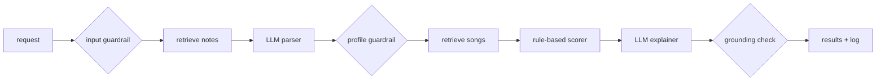

# 🎵 Music Recommender Simulation

## Project Summary

In this project you will build and explain a small music recommender system.

Your goal is to:

- Represent songs and a user "taste profile" as data
- Design a scoring rule that turns that data into recommendations
- Evaluate what your system gets right and wrong
- Reflect on how this mirrors real world AI recommenders

Replace this paragraph with your own summary of what your version does.

---

## How The System Works

Explain your design in plain language.

Real-world platforms like Spotify and YouTube combine two main approaches. **Collaborative filtering** looks at the behavior of many users (plays, skips, likes, playlist adds) and recommends what similar listeners enjoyed. **Content-based filtering** looks at the attributes of the items themselves (genre, tempo, audio features) and recommends songs similar to what a user already likes. Large systems blend both with signals like listening history and context, then rank millions of candidates by predicted engagement. My version is a small content-based recommender. With no listening history to learn from, it compares each song's attributes directly to a user's stated taste profile. It prioritizes **genre** first, because it is the most stable part of someone's taste. Next comes **mood**, because it captures the listening situation and connects songs across genres. Then **energy**, scored by how *close* a song is to the user's target rather than how high or low it is. Each score also comes with plain-language reasons, so every recommendation can be explained.

Some prompts to answer:

- What features does each `Song` use in your system
  - For example: genre, mood, energy, tempo

  My scoring uses `genre`, `mood`, `energy`, and `acousticness`. The other columns (`tempo_bpm`, `valence`, `danceability`) are stored on each `Song` but not scored. In this dataset, tempo and danceability are highly correlated with energy (0.96 and 0.86), so scoring them would count the same "calm vs. intense" trait several times. Valence varies too little (0.48–0.84) to separate songs well. `id`, `title`, and `artist` are used for display only.

- What information does your `UserProfile` store

  - `favorite_genre` (e.g. `"lofi"`)
  - `favorite_mood` (e.g. `"chill"`)
  - `target_energy`: a value from 0.0 to 1.0 describing how energetic the user wants their music to be
  - `likes_acoustic`: `True` or `False`

- How does your `Recommender` compute a score for each song

  Each song gets points from four parts, added together:

  | Feature | Rule | Max points |
  |---|---|---|
  | Genre | Exact match = 2.0; related genre (pop ↔ indie pop, lofi ↔ ambient) = 1.0 | 2.0 |
  | Mood | Exact match = 1.5 | 1.5 |
  | Energy | `1.5 × (1 − abs(song.energy − target_energy))`, which rewards closeness, not just high or low values | 1.5 |
  | Acousticness | `0.5 × acousticness` if the user likes acoustic, otherwise `0.5 × (1 − acousticness)` | 0.5 |

  Genre is weighted slightly above mood because a genre mismatch feels more "wrong" than a mood mismatch. The gap is kept small so mood can still break ties and surface good songs from related genres. Every rule that adds points also adds a reason (e.g. "matches your favorite genre: lofi"), and those reasons become the explanation for the recommendation.

- How do you choose which songs to recommend

  The recommender scores every song in the catalog, sorts them from highest to lowest score, and returns the top `k` (default 5) along with each song's score and explanation.

You can include a simple diagram or bullet list if helpful.

```
UserProfile ─┐
             ├─► score_song() for every song ─► sort by score ─► top k + reasons
songs.csv  ──┘
```

### Algorithm Recipe (final)

**Input:** a user's taste profile (favorite genre, favorite mood, target energy, likes acoustic or not) and the list of songs from `data/songs.csv`.

**Steps, for every song in the list:**

1. Start the song at **0 points** with an empty list of reasons.
2. **Genre:** If the song's genre is the same as the user's favorite, add **+2.0**. If it is a close cousin (pop ↔ indie pop, lofi ↔ ambient), add **+1.0**.
3. **Mood:** If the song's mood is the same as the user's favorite, add **+1.5**.
4. **Energy:** Add up to **+1.5** depending on how close the song's energy is to the user's target. A perfect match gets all 1.5 points. The further away it is, the fewer points it gets.
5. **Acoustic:** Add up to **+0.5**. If the user likes acoustic music, more acoustic songs get more points. If not, less acoustic songs get more points.
6. Every time points are added, write down a short reason, like "matches your favorite genre: lofi".

**Output:** Sort all songs from highest to lowest score and show the **top 5**, each with its score and reasons.

The best possible score is **5.5**. Text is compared in lowercase, so "Lofi" and "lofi" count as a match.

### Biases I Expect

- **Genre can beat everything else.** Genre is the biggest single reward. A song in the "right" genre but with the wrong feel may rank above a great song that matches the user's mood and energy but is in a different genre.
- **Exact words only.** Mood and genre must match word for word. "chill" and "relaxed" mean almost the same thing, but the system treats them as completely different. Genres like "rock" and "metal" get no partial credit because I only listed two related-genre pairs.
- **Some users get better results.** The catalog has 3 lofi songs but only 1 song for most other genres. A lofi fan gets several strong matches. A blues or classical fan gets one match, and the rest of their list is filled by energy alone.
- **No surprises.** The system only recommends what the user already said they like, so it never helps them discover a new genre.
- **Energy does a lot of the work.** Most songs don't match on genre or mood, so their ranking comes down to energy. Two very different songs with similar energy can look equally good.

---

## Getting Started

### Setup

1. Create a virtual environment (optional but recommended):

   ```bash
   python -m venv .venv
   source .venv/bin/activate      # Mac or Linux
   .venv\Scripts\activate         # Windows

2. Install dependencies

```bash
pip install -r requirements.txt
```

3. Run the app:

```bash
python -m src.main
```

4. Or launch the TuneJudge web GUI (Streamlit):

```bash
streamlit run src/app.py
```

The GUI has the same scoring logic as the CLI, organized into five pages in the top navigation:

- **AI Assistant (home):** type what you want to hear, or click an example ("Road trip", "Deep focus"…). You get grounded recommendations with an explanation for each pick and a step-by-step view of how the answer was built. The model, auto-switch and number of songs are under **Settings**. See [Ask AI: RAG + guardrails](#-ask-ai-rag--guardrails) below.
- **Explore:** set a taste profile in the sidebar (start from any preset in `main.py`, including the edge-case profiles, or type your own genre) and get ranked song cards with a match ring, a colored bar showing which rules earned points, and the "why" reasons.
- **Insights:** a stacked bar chart of each pick's points by rule with plain-language takeaways, plus **Compare profiles**, which shows two profiles side by side with shared songs highlighted. The sidebar's **Scoring lab** changes each rule's weight live.
- **Catalog:** every song plotted by energy vs. acousticness with your picks highlighted, plus the full searchable ranking.
- **About:** the pipeline, reliability settings and live offline-evaluation metrics.
- **Listen:** every recommendation card has an embedded Spotify player, and the Catalog table links each song to Spotify.
- **Guardrails:** a warning when your genre or mood isn't in the catalog or no song is a strong match, and energy values outside 0–1 are clamped instead of producing negative points.

### The song catalog

`data/songs.csv` holds about 950 real, **English-language** songs with no duplicates. Their Spotify track ids and audio features (energy, tempo, valence, danceability, acousticness) come from the public [Spotify Tracks Dataset](https://huggingface.co/datasets/maharshipandya/spotify-tracks-dataset).

- **Songs 1–19** are hand-picked, one per original genre/mood slot (Levitating, Smells Like Teen Spirit, Take Five, Nightcall, ...), with moods assigned by hand.
- **Songs 20+** are the most popular tracks in each of the 16 genres (up to 70 per genre). Latin songs are excluded. The dataset has no mood labels, so each song gets the mood of the closest example in the original hand-labeled catalog, compared on energy, valence, danceability and acousticness. These moods are approximate.
- **English only:** the dataset has no language field either, and its genre labels are noisy (Mexican banda filed as r&b, Punjabi rap as hip hop). A vocal track is kept only if its title and its artist's titles read as English, the artist isn't mostly filed under non-English genres, and the artist isn't on a hand-reviewed exclusion list in `scripts/build_catalog.py`. **Instrumental tracks are kept**, since they have no lyrics; that's what keeps lofi, ambient and classical in the catalog. Because of this filter, some genres have fewer songs (reggae 22, r&b 32, hip hop 38).
- **No duplicates:** the dataset lists many songs more than once (remasters, re-releases, the same track under several genres). Songs are de-duplicated by Spotify id and by normalized title + lead artist.

To rebuild the catalog (downloads the dataset, about 20 MB, into `.cache/`):

```bash
python scripts/build_catalog.py                 # default: up to 70 songs per genre
python scripts/build_catalog.py --per-genre 100 # bigger catalog (new songs may need a language review)
```

The original catalog of 20 made-up songs, which the sample outputs below and the model card were written against, is kept in `data/songs_original.csv`.

### Running Tests

Run the starter tests with:

```bash
pytest
```

You can add more tests in `tests/test_recommender.py`.

`tests/test_rag.py` covers the AI pipeline below with a fake LLM client (plus fake Claude, Gemini and OpenAI SDK responses, and auto-switch cases), so the whole suite runs offline and free.

### 🤖 Ask AI: RAG + guardrails

The **AI Assistant** page takes a plain-English request ("calm music for studying", "i just got dumped") and returns grounded recommendations. Code: [`src/rag.py`](src/rag.py). Architecture: [`diagrams/architecture.mmd`](diagrams/architecture.mmd).



1. **Input guardrail:** blocks empty, very long (over 500 characters) or prompt-injection requests before any API call is made.
2. **Retrieve:** a small TF-IDF index searches [`data/knowledge/music_notes.md`](data/knowledge/music_notes.md) (genre, mood and activity notes built from catalog averages) for notes that match the request.
3. **Parse (LLM):** using those notes, the model converts the request into a taste profile through structured output. If the request isn't about music, it's declined.
4. **Profile guardrail:** genre and mood are snapped to real catalog values, energy is clamped to 0–1, and every fix is shown to the user.
5. **Retrieve + score:** the song index pulls 120 candidates, and the same transparent scorer as the rest of the app ranks them.
6. **Explain (LLM):** the model writes a "why" for each pick using only the retrieved song data.
7. **Grounding guardrail:** the explanation is rejected if it names a song that wasn't recommended, uses wrong song ids, or quotes a number that isn't in the data. In that case the app falls back to the scorer's own reasons.

**Three AI providers:** the LLM steps can run on **Claude** (`claude-opus-5-5`, Anthropic), **Gemini** (`gemini-3.8-flash`, Google) or **OpenAI** (`gpt-6.1-terra`). Retrieval, scoring and all guardrails are identical for all three. `LLM_PROVIDER` in `.env` sets the default, and the AI Assistant's Settings let you pick one.

**Auto-switch:** each AI call times out after 30 s (`LLM_TIMEOUT_S`). If the chosen provider times out, is overloaded (503/529) or is rate-limited (429), the pipeline retries the same step on the next provider that has a key, and the app shows "Gemini was busy, so Claude answered this one". Refusals and bad API keys are never passed to another provider, so they stay visible. You can turn this off with the toggle in the AI Assistant's Settings. The eval script never auto-switches, so each score belongs to the provider it names. Each request is logged to `logs/tunejudge.jsonl` along with the provider and model that answered.

To add your keys, copy `.env.example` to `.env` and paste in any of the keys (one is enough). `.env` is git-ignored, and a key exported in your shell takes priority over it.

```bash
cp .env.example .env        # then edit .env: ANTHROPIC_API_KEY=sk-ant-...  /  GEMINI_API_KEY=...  /  OPENAI_API_KEY=sk-...
streamlit run src/app.py
```

**Evaluation:**

```bash
python scripts/eval_rag.py          # offline (free): notes hit@4, candidate recall@5, adversarial inputs blocked
python scripts/eval_rag.py --live                  # 12 golden + 2 off-topic queries on LLM_PROVIDER (~26 API calls)
python scripts/eval_rag.py --live --provider all   # every provider with a key, same queries
```

Offline results: notes hit@4 **92%** (11/12; "festival drops" found the EDM/euphoric notes, not the party note), candidate recall@5 **100%**, adversarial inputs blocked **7/7**. Each run writes a JSON report to `logs/`.

---

## Sample Recommendation Output

Output of `python3 src/main.py` for the default profile (a late-night study listener: lofi, chill, low energy, likes acoustic):

```
$ python3 src/main.py
Loaded songs: 20

================================================================
  🎵  Top Recommendations
================================================================
  Profile: lofi · chill · energy 0.40 · acoustic
----------------------------------------------------------------

  #1  Library Rain  —  Paper Lanterns
      lofi / chill
      Score: 5.35 / 5.5  ███████████████████░
      Why:
        • genre match: lofi (+2.0)
        • mood match: chill (+1.5)
        • energy 0.35 vs target 0.40 (+1.42)
        • acoustic sound (+0.43)

  #2  Midnight Coding  —  LoRoom
      lofi / chill
      Score: 5.32 / 5.5  ███████████████████░
      Why:
        • genre match: lofi (+2.0)
        • mood match: chill (+1.5)
        • energy 0.42 vs target 0.40 (+1.47)
        • acoustic sound (+0.35)

  #3  Spacewalk Thoughts  —  Orbit Bloom
      ambient / chill
      Score: 4.28 / 5.5  ████████████████░░░░
      Why:
        • related genre: ambient (+1.0)
        • mood match: chill (+1.5)
        • energy 0.28 vs target 0.40 (+1.32)
        • acoustic sound (+0.46)

  #4  Focus Flow  —  LoRoom
      lofi / focused
      Score: 3.89 / 5.5  ██████████████░░░░░░
      Why:
        • genre match: lofi (+2.0)
        • energy 0.40 vs target 0.40 (+1.50)
        • acoustic sound (+0.39)

  #5  Coffee Shop Stories  —  Slow Stereo
      jazz / relaxed
      Score: 1.90 / 5.5  ███████░░░░░░░░░░░░░
      Why:
        • energy 0.37 vs target 0.40 (+1.46)
        • acoustic sound (+0.45)

================================================================
```

### Second example: pop / happy profile

This is the profile the starter tests use (pop, happy, energy 0.80, non-acoustic). Sunrise City matches on all four features and ranks #1, as expected.

```
================================================================
  🎵  Top Recommendations
================================================================
  Profile: pop · happy · energy 0.80 · non-acoustic
----------------------------------------------------------------

  #1  Sunrise City  —  Neon Echo
      pop / happy
      Score: 5.38 / 5.5  ████████████████████
      Why:
        • genre match: pop (+2.0)
        • mood match: happy (+1.5)
        • energy 0.82 vs target 0.80 (+1.47)
        • non-acoustic sound (+0.41)

  #2  Rooftop Lights  —  Indigo Parade
      indie pop / happy
      Score: 4.26 / 5.5  ████████████████░░░░
      Why:
        • related genre: indie pop (+1.0)
        • mood match: happy (+1.5)
        • energy 0.76 vs target 0.80 (+1.44)
        • non-acoustic sound (+0.33)

  #3  Gym Hero  —  Max Pulse
      pop / intense
      Score: 3.78 / 5.5  ██████████████░░░░░░
      Why:
        • genre match: pop (+2.0)
        • energy 0.93 vs target 0.80 (+1.30)
        • non-acoustic sound (+0.47)

  #4  Concrete Verses  —  Kilo Static
      hip hop / confident
      Score: 1.91 / 5.5  ███████░░░░░░░░░░░░░
      Why:
        • energy 0.78 vs target 0.80 (+1.47)
        • non-acoustic sound (+0.44)

  #5  Night Drive Loop  —  Neon Echo
      synthwave / moody
      Score: 1.81 / 5.5  ███████░░░░░░░░░░░░░
      Why:
        • energy 0.75 vs target 0.80 (+1.42)
        • non-acoustic sound (+0.39)

================================================================
```

One result here is a weakness. **Fiesta en la Calle** (latin, playful, energy 0.85) sounds like one of the happiest songs in the catalog, but it lands at **#7** and doesn't make the top 5. "Playful" isn't an exact match for "happy", so it gets no mood points, and even the *moody* "Night Drive Loop" beats it. Below the top 3, the order is decided almost entirely by energy.

**Screenshot or video** *(optional)*: <!-- Insert a screenshot or demo video link here -->

---

## Experiments You Tried

Use this section to document the experiments you ran. For example:

- What happened when you changed the weight on genre from 2.0 to 0.5
- What happened when you added tempo or valence to the score
- How did your system behave for different types of users

---

## Limitations and Risks

Summarize some limitations of your recommender.

Examples:

- It only works on a tiny catalog
- It does not understand lyrics or language
- It might over favor one genre or mood

You will go deeper on this in your model card.

---

## Reflection

Read and complete `model_card.md`:

[**Model Card**](model_card.md)

### Personal Reflection on My Engineering Process

**What was my biggest learning moment?**
It was when I looked at my own profile (reggae, focused, energy 0.8). Island Breeze Riddim came out #1 even though it missed my mood and my energy. At first I thought my scoring was wrong. But the math was fine. The real cause was the data: it is the only reggae song in the catalog. A genre match is worth 2.0 points, and a song with no genre or mood match can never score more than 2.0. So that one song was guaranteed to win. That's when I understood that a recommender is only as fair as its data. Code can be correct and still give some users a worse experience.

**How did AI tools help me, and when did I need to double-check them?**
AI helped me move fast. It wrote edge-case profiles I wouldn't have thought of, like an "acoustic metalhead" and an energy value of 1.5. It ran the program for all profiles, compared results before and after my weight experiment, and turned the findings into plain language. I still had to check its work:
- **The math.** After the weight shift, I made sure every score still equaled the sum of its reasons and that the new maximum was 6.0, not 5.5.
- **Where things went.** It sometimes put content in a different place than I wanted, like the README instead of the model card. It also added an example I had only meant as a style guide. I had to tell it to move or remove those.
- **What was left behind.** The weight experiment stayed in the code after we finished. That meant the numbers in my model card didn't match a fresh run of the program.
- **Its choices.** It made some decisions for me, like the name "TuneJudge" and comparing 9 pairs of profiles instead of all 36. These were reasonable, but they were my calls to make, not the AI's.

**What surprised me about how simple algorithms can still "feel" like recommendations?**
My system is just four point rules and a sort. It doesn't listen to music at all. Still, the Chill Lofi results felt like a real study playlist. The "Why" bullets under each song made it feel smart and personal. The surprise was the other side: it feels just as confident when it's wrong. The k-pop user got a neat top 5 with scores around 1.5 out of 5.5, and nothing on screen says "these don't really fit you." A tidy list with reasons makes almost anything look like a good recommendation.

**What would I try next?**
- Add more songs so every genre has at least 5. This would fix the one-song filter bubble.
- Give partial credit for similar moods, like "happy" and "playful," the way I already do for related genres.
- Show a "no strong match" message when the best score is low, and reject energy values outside 0 to 1.
- Let users pick more than one favorite genre, and keep the top 5 from being all the same style.


